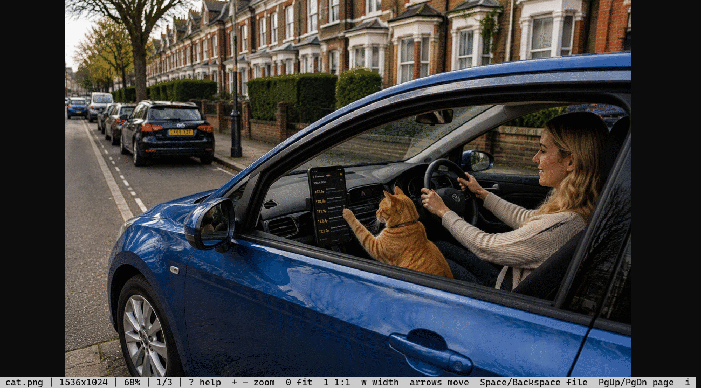
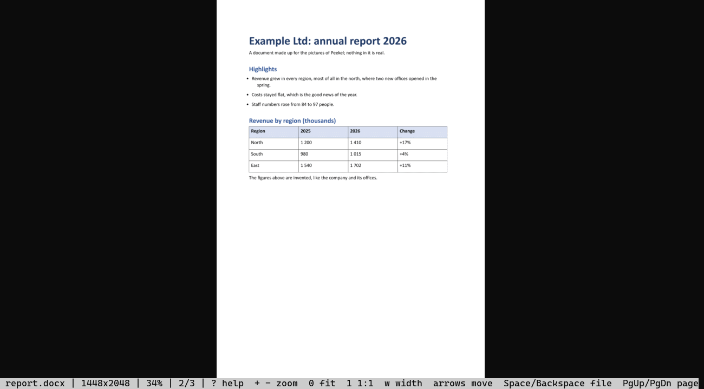
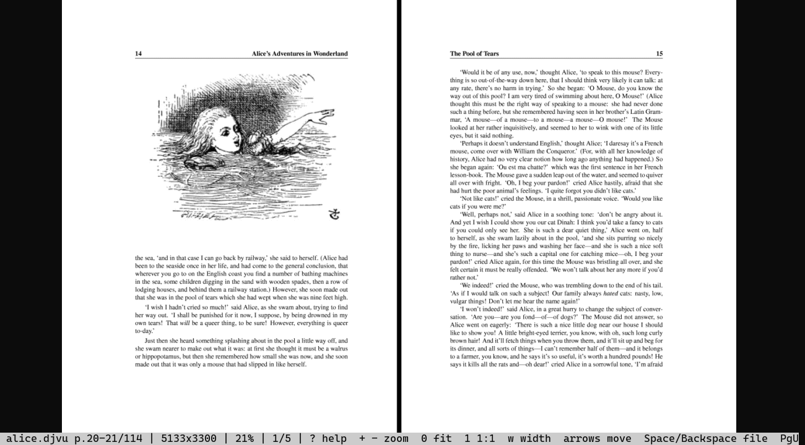
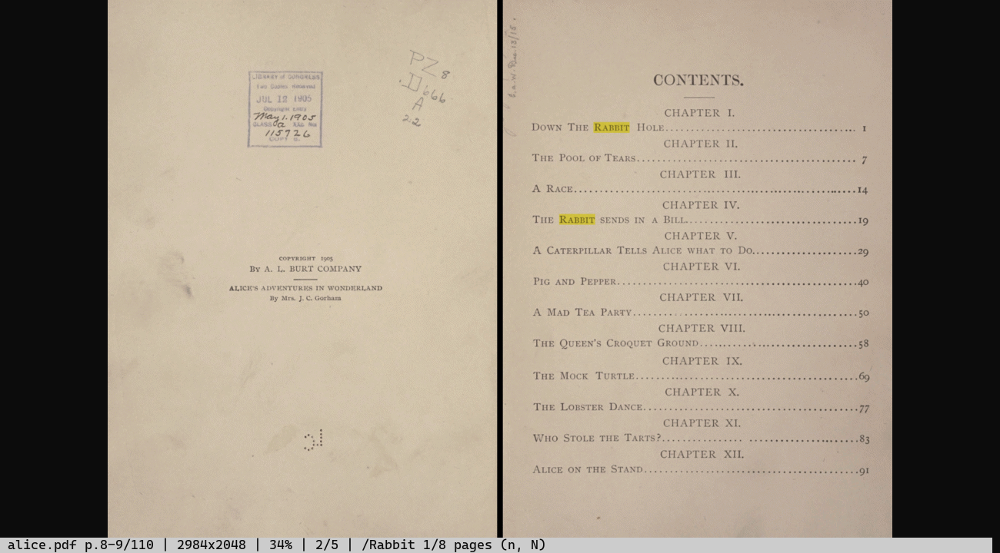

# Peekel viewer

**A file viewer for the terminal that also reads books.** `peekel` shows a picture, an SVG, the start of a Word, Excel, PowerPoint or
OpenDocument file, and a card for any other file; and it reads PDF, DjVu, FB2 and EPUB books (and HTML pages) page by page, with their
contents, a search in the text and the place you stopped at kept. It draws with Sixel graphics in the terminal's own cells, so it works in Windows Terminal, on
Linux and over SSH, and it can be the F3 viewer of Far Manager or Midnight Commander.



## Why

- **One small program** for Windows and Linux, nothing to install beside it.
- **More than pictures.** The start of a document, and on request a card for anything else: a font in its own letters, a program's
  version and icon, what is inside an archive.
- **Books too.** Two or three pages side by side, the contents of the book (`c`), a search in the text (`/`), a page scanned on its
  side turned with a key, and every book opens where you left it. FB2 and EPUB are laid out into pages by the viewer itself,
  justified, and the size of their text is yours to choose. Russian words are also hyphenated at the end of a line; text in other
  languages is set without hyphenation.
- **Quick:** the next and the previous page or file are made ready while you look at this one.
- **Damaged files are safe:** every reader has limits on size and depth; a broken file gives a message, not a crash.
- Written in Rust. Open source, MIT or Apache-2.0.

A note on pictures: Sixel gives a picture at most 255 colours (in Windows Terminal), so a photograph is shown to see what is in it, not
for its last detail of colour.

## What it looks like

The screens are drawn from what the program wrote to a terminal of 130 x 36 cells ([credits](docs/images/CREDITS.md)).

**A Word document**



**A DjVu book, two pages side by side**



**A word found in the text of a scanned PDF, marked on the page**



## What it opens

| What | |
|---|---|
| PNG, JPEG, GIF (first frame), BMP, WebP, TIFF, SVG, JPEG XL, DDS | the picture |
| RAW photographs (NEF, CR2, ARW, DNG, ORF, PEF and others) | the camera's own JPEG preview |
| Word (.docx), PowerPoint (.pptx), Excel (.xlsx) | the start, the first slide, the top of the sheet |
| OpenDocument (.odt, .ods, .odp) | the start, the top of the sheet, the first slide |
| PDF (not password-protected) | the pages; `c` its bookmarks, `/` a search in its text (a scan has no text) |
| DjVu (scanned books) | the pages; `c` its bookmarks, `/` a search in a book with a text layer |
| FB2 (also `.fb2.zip`), EPUB (without DRM) | the book laid out into pages; `c` its contents, `/` a search, `f` `F` a larger, smaller text |
| HTML (.html, .htm, .xhtml) saved on the disk | the page laid out as a book, its headings the contents; no styles or scripts |
| BitTorrent (.torrent) | a card: the name, the size and files, the largest named, who made it and when, the tracker, private or not, the info-hash |
| Fonts, programs (exe, dll), ZIP, gzip, anything else | a card with the kind, size, dates and what is inside (when the settings say so) |

EXIF orientation is honoured and a colour profile is converted to sRGB. **Documents are previews, not copies**: words are wrapped by a
guess, and charts, text boxes, headers and footers are not drawn. HEIC and AVIF are not read yet; the Far plugin opens them where
Windows has the codec.

## What you need

A terminal that shows Sixel graphics: on Windows, **Windows Terminal 1.22 or newer**; on Linux, one with Sixel, such as foot, mlterm or
xterm. The program asks the terminal and says so when it does not show Sixel.

- **Windows:** 64-bit.
- **Linux:** x86-64, glibc 2.39 or newer (Ubuntu 24.04, Debian 13, Fedora 40 or newer); it does not start on an older system.

## Install

Take the archive for your system from the [latest release](../../releases/latest) and check it against its `.sha256` file.

- **Windows:** `Peekel-viewer-<version>-windows-x64.zip`.
- **Linux:** `Peekel-viewer-<version>-linux-x86_64.tar.gz`.

Unpack it, open a terminal in that folder and run `.\peekel.exe --install` (Windows) or `./peekel --install` (Linux). It asks before
each step:

- copies itself to `%LOCALAPPDATA%\Programs\peekel` and puts that folder on your `PATH` (Windows), or to `~/.local/bin` with its
  free fonts in `~/.local/share/peekel/fonts` (Linux);
- sets F3 of **Far Manager** and F3 and Enter of **Midnight Commander** to open the files it reads, if it finds them (below). Far
  must be closed for this; a Midnight Commander that is open picks it up when it is started again. Neither is needed: without them
  this step is passed over.

**A new version** is installed the same way: unpack it and run its `--install`. It replaces the program and brings the file
managers' list of files up to date (a new version may read more of them); your settings and the places in your books are kept.

`peekel --uninstall` takes all of it away again. Without installing, `peekel` also runs from where it was unpacked (on Linux keep its
`fonts` folder beside it).

From source: install Rust (the version is in `rust-toolchain.toml`) and run `cargo build --release -p peekel`.

## Using it

```
peekel photo.jpg
peekel report.docx
peekel book.djvu
```

Space and Backspace go to the next and the previous file of the folder. The line at the bottom says what is shown and the main keys;
`?` lists them all.

**Looking at a page or a picture**

| Keys | Do |
|---|---|
| `+` `-`, the mouse wheel | zoom in, out (the zoom stays on the next pages of the book) |
| `0`, `1`, `w` | the whole page, one pixel to one, as wide as the window |
| arrows or `h j k l`, dragging | move it (with Shift half a window, with Ctrl a whole one) |
| Space, Backspace, a click at the right or left edge | the next, the previous file |
| `g`, `G` | the first, the last file of the folder |
| `i` | the properties of the file (a photo's EXIF, a document's author and pages) |
| `y` | copy the file's path to the terminal's clipboard |
| `m` | copy the magnet link of a `.torrent` to the clipboard |
| `s` | the settings |
| `?`, F1 | all the keys |
| `q`, Esc, Enter | close |

**Reading a book**

| Keys | Do |
|---|---|
| Page Down, Page Up | the next, the previous spread |
| Home, End | the beginning, the end of the book |
| `p` | go to a page by its number (as the line at the bottom counts them) |
| `c` | the contents; Enter goes to the chapter |
| `/`, `n`, `N` | find a word; the next and the previous page that has it (the word is marked) |
| `d`, `o`, `e` | pages side by side (2, 3, 1); the first page alone or with the second; pages equally high or not |
| `r`, `R` | turn the page a quarter clockwise, back |
| `f`, `F` | a larger, a smaller text in FB2, EPUB and HTML (70 to 200 %; the book is laid out again, you stay at your place) |

The keys work with any keyboard layout in Windows Terminal, and with the Russian layout in any terminal.

**The settings** (`s`, or the file `settings` beside the state below): pages side by side for each book or one choice for all, the
defaults of a spread, the size of the text of FB2, EPUB and HTML, and **which files Space goes through**: pictures and documents (the
default), books only (PDF, DjVu, FB2 and EPUB, for reading), or every file (the others shown as cards).

Options: `--cards` goes through every file for one run, `--no-state` neither keeps nor uses the place in each book, `--no-status`
leaves out the line at the bottom, `--any-key` closes on any key, `--force` draws even when the terminal does not say it shows Sixel
(tmux and screen do not), `--timing` prints how long each stage took.

**What it keeps:** the page, the zoom and the turns of the last 200 books, and the settings, in `%APPDATA%\peekel` on Windows and in
`$XDG_STATE_HOME/peekel` (or `~/.local/state/peekel`) on Linux. Nothing is written next to your files.

## F3 in Far Manager and Midnight Commander

`peekel --setup far` and `peekel --setup mc` do it (and `--install` offers them); run them again after an update, when a new version
reads more files. What they change is backed up first.

- **Far Manager** (close it first): its own file association, put first, with F3 running `peekel.exe "!.!"`; an association of yours
  that only runs `peekel.exe` is replaced, any other is kept.
- **Midnight Commander:** a section `[Peekel]` first in `~/.config/mc/mc.ext.ini`. mc reads either that file or the system's
  (`/etc/mc/mc.ext.ini`), not both, so when you have none it is made as a copy of the system's, as mc's own "Edit extension file"
  does; mc takes the first section that matches, so F3 and Enter both open these files in `peekel`.

By hand: `peekel --masks far` and `peekel --masks mc` print what is below, for the files this version reads.

- **Far Manager:** F9 › Commands › File associations, add this mask and set the command for F3 to `C:\path\to\peekel.exe "!.!"`:

  ```
  *.png,*.jpg,*.jpeg,*.jfif,*.gif,*.bmp,*.webp,*.tif,*.tiff,*.dds,*.nef,*.nrw,*.cr2,*.arw,*.sr2,*.srf,*.dng,*.orf,*.pef,*.3fr,*.erf,*.mef,*.kdc,*.dcr,*.rw2,*.jxl,*.svg,*.svgz,*.pdf,*.djvu,*.djv,*.fb2,*.fb2.zip,*.fbz,*.epub,*.html,*.htm,*.xhtml,*.docx,*.odt,*.ods,*.odp,*.pptx,*.xlsx,*.torrent
  ```

  For the quick view of Far's panel (Ctrl+Q) there is a plugin of its own, [Peekel for Far Manager](https://github.com/loglux/peekel).
- **Midnight Commander:** first in `~/.config/mc/mc.ext.ini`, after its `[mc.ext.ini]` and `Version` (if you have no such file, copy
  `/etc/mc/mc.ext.ini` there first, or mc loses its other associations):

  ```ini
  [Peekel]
  Regex=\\.(png|jpg|jpeg|jfif|gif|bmp|webp|tif|tiff|dds|nef|nrw|cr2|arw|sr2|srf|dng|orf|pef|3fr|erf|mef|kdc|dcr|rw2|jxl|svg|svgz|pdf|djvu|djv|fb2|fb2\\.zip|fbz|epub|html|htm|xhtml|docx|odt|ods|odp|pptx|xlsx|torrent)$
  RegexIgnoreCase=true
  Open=peekel %f
  View=peekel %f
  ```

## Fonts on Linux

The text of documents and cards is set in the fonts they name (Calibri, Arial, Segoe UI...), which a Linux system has not. The Linux
archive brings free fonts of the same widths in its `fonts` folder (Carlito for Calibri, Liberation for Arial, Times New Roman and
Courier New, Selawik for Segoe UI, Caladea in place of Cambria), so documents are laid out as they should be without anything else.
The original fonts are used wherever they are found:

- copy them from your own Windows or Office into `~/.local/share/fonts` (every program sees them), or into a folder of your own named
  by `PEEKEL_FONTS` (a list like `PATH`) or by the line `fonts = ...` of the settings file;
- or install your distribution's package of Microsoft's core fonts (on Ubuntu `ttf-mscorefonts-installer`: Arial, Times New Roman,
  Courier New and others, not Calibri or Segoe UI).

## When the picture is the wrong shape

Windows Terminal tells every program that a character cell is 10 x 20 pixels, whatever the font is; the real size depends on the font
and the scale of the screen (Consolas at 150 % is 13 x 28). On Windows the viewer works the real size out from the window. **In WSL
and over SSH** it cannot see the window, and with a font that is not twice as high as it is wide the picture comes out stretched; give
the real size by hand:

```
export PEEKEL_REAL_CELL=13x28
```

`peekel --timing` prints the size it found.

## Licence

Peekel is under **either** of the [MIT licence](LICENSE-MIT) or the [Apache License 2.0](LICENSE-APACHE), at your option.
Copyright (c) 2026 Vladislav Sorokin. The licences of the libraries inside the program are in `THIRD-PARTY-LICENSES.txt` in the
archive, and those of the fonts in the Linux archive's `fonts` folder; all are permissive (MIT, Apache-2.0, BSD, Zlib, Unicode, SIL OFL).
